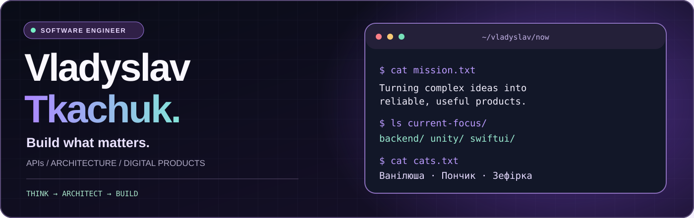
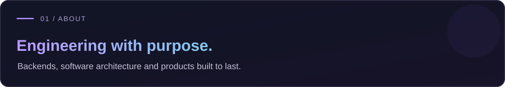
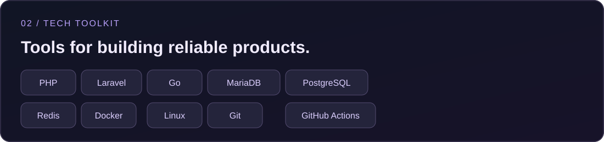
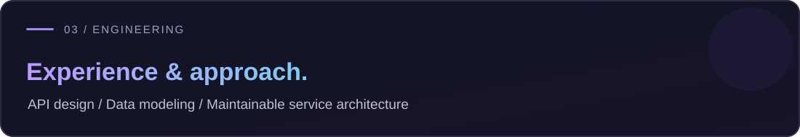
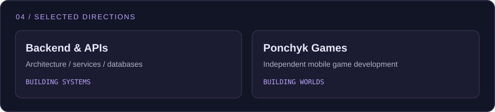
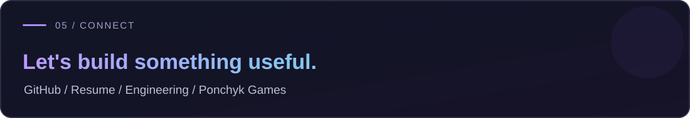

  

 

I'm **Vladyslav Tkachuk**, a Backend Engineer from Ukraine with experience across **mobile app APIs, fintech and payment integrations, analytics systems, CRM platforms, marketplaces, and asynchronous processing**.

I work primarily with **PHP / Laravel and Node.js / NestJS**. I care about clean architecture, reliable systems and practical engineering. Outside commercial work I explore **Go** and modern backend architecture.

**Backend:** PHP · Node.js · Laravel · Symfony · NestJS · Express  
**Data:** MySQL · PostgreSQL · MongoDB · Redis · Manticore Search  
**Systems:** REST APIs · Socket.IO · BullMQ · RabbitMQ · Docker · Git

| Period | Experience | Highlights |
| :--- | :--- | :--- |
| 2024–2025 | **Logic Fusion** | Mobile APIs, Stripe / PayPal / Braintree, Firebase, OpenAI integrations |
| 2024–2025 | **Traffhunt** | Tracking analytics, CRM messaging, PWA builder, push platform |
| 2023–2024 | **VIDI** | Credit calculation systems, Webpack performance optimization |
| 2022–2023 | **Kronas** | Internal APIs, automation, integrations |
| 2018–2022 | **Technoskarb** | Marketplaces, catalog/search and payments |

*Some employment periods overlap as recorded in the source CV. Descriptions and dates are pending personal review.*

**[Explore detailed experience and technologies →](./CV.md)**

| Technical area | What I have worked on |
| --- | --- |
| **Mobile API integrations** | Payment gateways, Firebase notifications and AI features |
| **Analytics platforms** | Campaign tracking, custom reporting, query/index optimization |
| **Real-time CRM** | Messaging integrations, lead tracking and Socket.IO |
| **Push infrastructure** | Scheduled notification delivery, queues and event analytics |
| **Backend architecture** | Service boundaries, performance and maintainable API design |

These are **experience summaries**, not links to unpublished employer code.

### `05 / BEYOND BACKEND`

<table><tr><td width="50%" valign="top">

**🎮 Indie Game Development**

Exploring mobile game development with **Unity and C#** — gameplay systems, match-3 mechanics, player progression, and how game clients connect to backends.

*Personal projects / in development.*

</td><td width="50%" valign="top">

**📱 iOS App Development**

Learning **Swift and SwiftUI** while prototyping native iOS app ideas, UI flows and product experiences.

*Learning & prototyping, not a claim of commercial Swift experience.*

</td></tr></table>

  

Think. Architect. Build. · 3 cats, 0 regrets.

