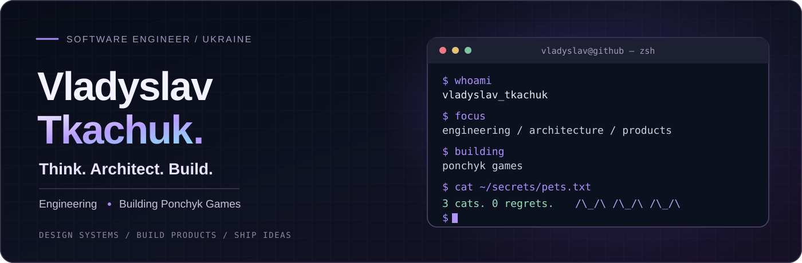

  
    
  
  

 

I'm **Vladyslav Tkachuk**, a software engineer based in Ukraine. I enjoy developing reliable backends, designing maintainable APIs, and turning technical ideas into usable products.

My interests span **backend engineering, software architecture, developer experience**, and independent product development.

I work with backend technologies and infrastructure tools, with a focus on clear structure, maintainable code, and practical engineering decisions.

From requirements and data modeling to API implementation, debugging, and iteration, I enjoy understanding software end to end.

**[Read my professional resume →](./CV.md)**

> The resume is currently a draft; verified employers, dates, and measurable achievements will be added after review.

**Backend & APIs** — Exploring maintainable service design, application architecture, and Go-based backends.

**Ponchyk Games** — Independent mobile game development, including work on **Cat Heist Match**. Development repositories are currently private.

  
  

 

  
  Think. Architect. Build. · 3 cats, 0 regrets.

